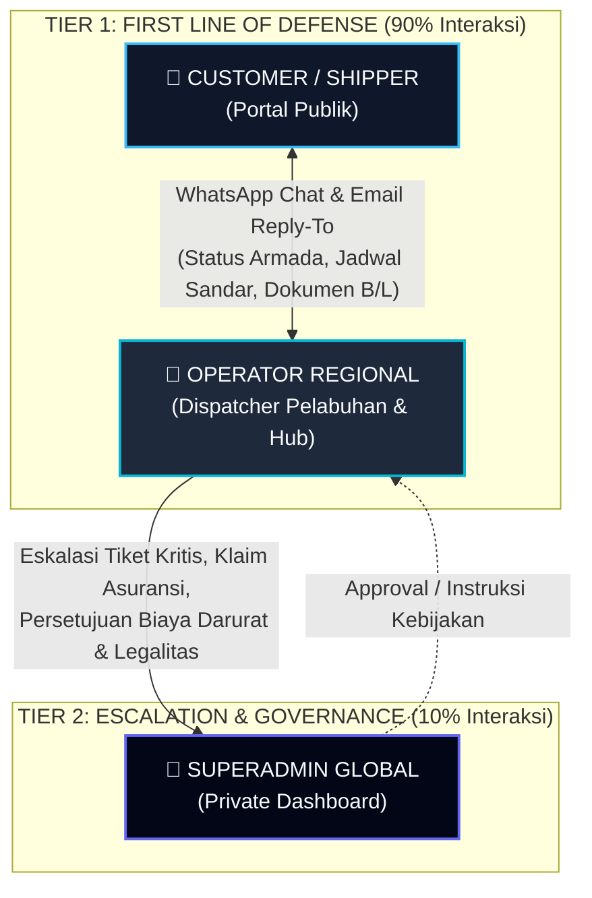
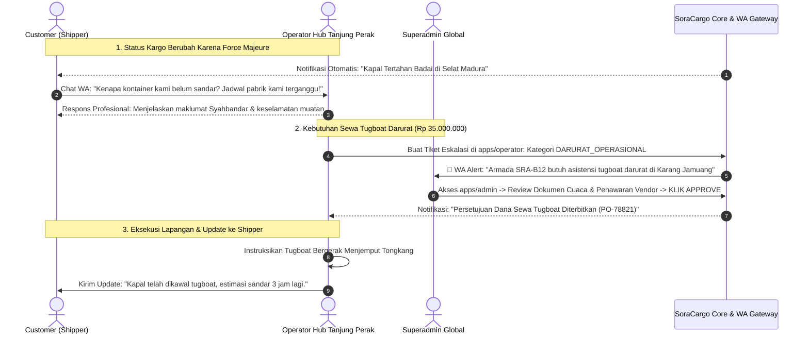
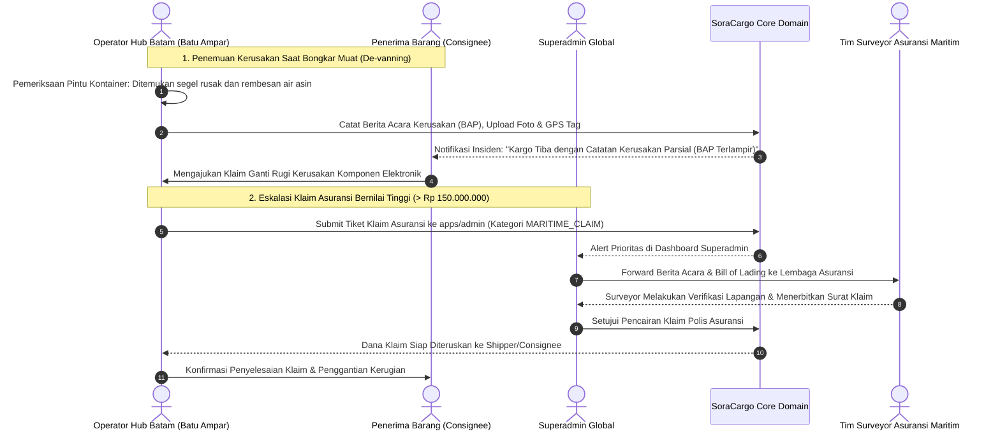

# Hierarki Komunikasi Berjenjang (Communication Flow & Gateway Integration)

Dokumen ini menjelaskan arsitektur komunikasi berjenjang (*Tiered Escalation*), perutean pesan melalui WhatsApp Gateway dan Email Gateway, serta penanganan insiden operasional di SoraCargo.

---

## 1. Prinsip Dukungan Berjenjang (Tiered Support)

Dalam industri logistik maritim dan kargo terpadu, saluran komunikasi yang tidak terkelola dengan baik dapat menyebabkan kepanikan pelanggan, informasi simpang siur, dan kelelahan manajerial (*managerial fatigue*).

SoraCargo menerapkan arsitektur **Tiered Support & Operational Escalation**:

### Aturan Emas Komunikasi:
1. **Pelanggan Tidak Pernah Berhubungan Langsung dengan Superadmin**: Seluruh interaksi awal, pelacakan rute, dan pertanyaan operasional diselesaikan oleh Operator Regional setempat.
2. **Eskalasi Terstruktur Berbasis Bukti**: Operator hanya meneruskan masalah ke Superadmin jika melewati batas kewenangan finansial (misal biaya darurat > Rp 10.000.000), sengketa hukum, atau anomali keselamatan armada.
3. **Pusat Kontrol Gateway Terisolasi**: Konfigurasi teknis WhatsApp Gateway (sesi perangkat, scan QR) dan SMTP Email Gateway dikelola eksklusif oleh Superadmin dari `apps/admin`.

---

## 2. Alur Gateway: WhatsApp & Email

### A. WhatsApp Gateway Routing
Platform menggunakan microservice in-house `services/wa-gateway` (berbasis Node.js & Baileys):

| Aksi | Titik Sentuh Pelanggan | Perutean Sistem | Penerima Akhir |
| :--- | :--- | :--- | :--- |
| **Tracking Otomatis** | Kirim nomor resi / B/L ke nomor bot WA. | Bot WA menanyakan status ke API internal Core Domain dan membalas posisi radar terakhir. | Customer (Automated Bot Response). |
| **Bantuan Dispatcher** | Klik tombol *"Hubungi Operator Hub"* di web dashboard. | Sistem mengarahkan *deep-link* WA (`https://wa.me/...`) langsung ke nomor WhatsApp resmi Dispatcher Regional sesuai pelabuhan asal muat. | Operator Regional setempat. |
| **Notifikasi Kargo Siap Ambil** | Kargo tiba di depo tujuan (*Ready for Pick-Up*). | Trigger event `CargoArrivedAtDestination`: Gateway mengirimkan pesan otomatis berisi PIN Pengambilan dan QR Code. | Customer. |
| **Alert Kritis ke Admin** | Operator menekan tombol *"Eskalasi ke Admin"* di portal `apps/operator`. | Gateway mengirimkan template pesan darurat prioritas tinggi ke nomor privat Superadmin. | Superadmin Global. |

### B. Email Gateway Routing
Setiap notifikasi email yang keluar dari SoraCargo memiliki konfigurasi *Header* cerdas:
- **`From`**: `SoraCargo Logistics <no-reply@soracargo.com>` (untuk pengumuman blast atau autentikasi).
- **`Reply-To` Dinamis**: Disesuaikan dengan Hub tempat kargo ditangani.
  - Kargo diberangkatkan dari Pelabuhan Tanjung Priok: `ops.jkt@soracargo.com`.
  - Kargo diberangkatkan dari Pelabuhan Tanjung Perak: `ops.sub@soracargo.com`.
  - Kargo ekspor internasional Singapura: `ops.sin@soracargo.com`.
- **Hasil**: Ketika pelanggan mengklik *Reply* pada email notifikasi resi mereka, email balasan otomatis masuk ke antrean inbox Operator Regional terkait, bukan ke inbox developer atau Superadmin.

---

## 3. Skenario Operasional Nyata (Real-World Case Studies)

Untuk menggambarkan bagaimana sistem beroperasi di bawah tekanan operasional nyata, berikut adalah 2 studi kasus konkret:

### Skenario 1: Cuaca Ekstrem Selat Madura & Permohonan Biaya Sewa Tugboat Darurat

#### Kronologi Langkah:
1. **Deteksi & Notifikasi**: Gelombang tinggi 3.5 meter di Selat Madura memaksa Syahbandar menerbitkan surat penundaan berlayar (SPB Hold). Status kargo otomatis berubah menjadi `WEATHER_HOLD` di portal customer.
2. **Interaksi Customer - Operator (Tier 1)**: Customer bertanya melalui chat WA ke Operator Hub Tanjung Perak. Operator memberikan informasi resmi BMKG tanpa melibatkan Admin.
3. **Kebutuhan Biaya Darurat**: Nahkoda kapal menginformasikan bahwa tongkang membutuhkan pengawalan kapal tunda (*tugboat*) darurat untuk bermanuver menghindari karang dengan biaya sewa Rp 35.000.000. Batas wewenang operator hanya Rp 10.000.000.
4. **Eskalasi ke Admin (Tier 2)**: Operator menekan tombol **"Eskalasi ke Superadmin"** di dashboard operator, melampirkan surat Syahbandar dan invoice proforma tugboat.
5. **Alert WA Instan**: WhatsApp Gateway mengirimkan pesan berprioritas ke Superadmin:
   > *"🚨 [ALERT ESKALASI OPS #TUG-201] Hub Tj. Perak membutuhkan persetujuan sewa Tugboat darurat Rp 35.000.000 untuk Armada SRA-B12 di Selat Madura demi menghindari risiko hanyut. Segera lakukan review di admin portal."*
6. **Keputusan Admin**: Admin membuka `apps/admin`, meninjau dokumen, dan mengklik **Approve Biaya**.
7. **Penyelesaian**: Operator menerima notifikasi dana disetujui, memesan tugboat, tongkang sandar dengan aman, dan customer menerima kabar pembaruan tanpa friksi.

---

### Skenario 2: Kargo Basah Terpapar Air Laut & Klaim Asuransi Maritim (Jakarta – Batam)

#### Kronologi Langkah:
1. **Penemuan di Lapangan**: Saat kontainer diturunkan di Pelabuhan Batu Ampar Batam, operator mencatat paking karet pintu kontainer sobek akibat cuaca badai di laut Jawa, menyebabkan 25 karton suku cadang elektronik basah air asin.
2. **Dokumentasi Bukti**: Operator membuat *Berita Acara Kerusakan Barang (BAP)* di `apps/operator`, memotret segel peti kemas, mencatat nomor seri segel, dan melampirkan lembar deklarasi *Marine Cargo Policy*.
3. **Pemberitahuan Transparan ke Konsumen**: Sistem memberikan status peringatan kuning pada resi customer: *"Tiba di Pelabuhan dengan Berita Acara Kerusakan Parsial"*. Customer langsung dihubungi oleh dispatcher operator setempat.
4. **Eskalasi ke Admin**: Karena nilai estimasi kerugian mencapai Rp 180.000.000 (melebihi batas wewenang lokal), tiket dieskalasikan ke Superadmin.
5. **Penanganan Asuransi oleh Admin**: Superadmin meneruskan dokumen digital ke perusahaan asuransi rekanan (*Underwriter*) melalui portal admin. Surveyor asuransi turun memeriksa barang di depo Batam.
6. **Pencairan & Retensi Pelanggan**: Setelah klaim disetujui asuransi, dana diteruskan ke rekening pelanggan sesuai ketentuan polis, menjaga kepercayaan pelanggan terhadap SoraCargo.

---

## 4. Manajemen Perangkat Gateway (Admin Only)

Untuk menjamin kedaulatan data dan mencegah penyalahgunaan nomor resmi perusahaan:
- **Hak Akses**: Halaman manajemen WhatsApp Gateway dan Email SMTP hanya tersedia di dashboard **`apps/admin`** (`/admin/settings/gateways`).
- **Fitur Khusus Admin**:
  - Scan QR Code untuk menautkan nomor WhatsApp resmi (*Multi-device pairing*).
  - Monitoring status online/offline koneksi WhatsApp socket Baileys.
  - Restart service WhatsApp Gateway tanpa mengganggu container aplikasi utama.
  - Pengaturan kuota kirim per jam (*rate-limiting*) untuk mencegah nomor WhatsApp terblokir oleh Meta.
  - Pengaturan template pesan otomatis (OTP, Booking Confirmed, Delivery Order Ready).
