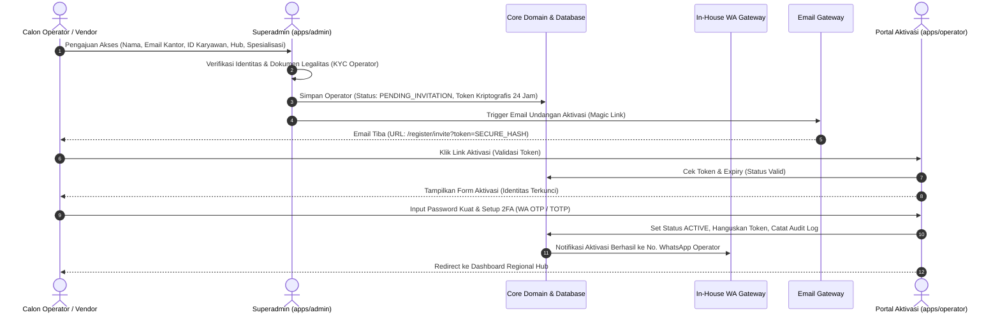

# Siklus Hidup Operator (Operator Lifecycle, Onboarding & RBAC)

Dokumen ini menjelaskan tata kelola akun operator di platform SoraCargo, mulai dari mitigasi pendaftaran terbuka (*zero public registration*), proses undangan berizin (*request & invitation token*), pemisahan peran (*Domestic vs. International*), hingga pengelolaan status akun oleh Superadmin.

---

## 1. Filosofi Keamanan: Zero Public Registration

Aplikasi operator (`apps/operator`) memegang peranan krusial dalam rantai pasok SoraCargo:
- Mengatur penugasan sopir dan nahkoda armada.
- Memperbarui status manifest kontainer dan posisi radar real-time.
- Mengunggah dokumen legalitas pengapalan (*Bill of Lading*, Surat Jalan, Berita Acara).
- Menyetujui pelepasan kargo di depo pelabuhan.

Oleh karena itu, **SoraCargo melarang keras pendaftaran publik terbuka (self-registration) untuk operator**. Siapa pun yang mengakses portal operator tanpa izin atau tanpa tautan kriptografi resmi dari Superadmin tidak dapat membuat akun.

---

## 2. Alur Permohonan & Undangan (Request & Invitation)

Pemberian hak akses operator dilakukan melalui alur verifikasi ganda terstruktur:



### Rincian Tahapan:
1. **Request Permohonan**:
   - Diajukan oleh pimpinan cabang regional atau pimpinan vendor ekspedisi ke Superadmin.
   - Melampirkan identitas resmi, email korporat (`@soracargo.com` atau domain vendor terdaftar), kontak darurat, penempatan hub, dan tipe spesialisasi kerja.
2. **Review & Approval Admin**:
   - Superadmin membuka modul *Operator Management* di `apps/admin`.
   - Admin memilih peran (*Domestic* atau *International*) dan cabang pelabuhan/depo asal.
   - Admin menekan tombol **"Approve & Send Invitation"**.
3. **Penerbitan Token Kriptografi**:
   - Sistem men-generate token unik 64-karakter acak menggunakan HMAC-SHA256.
   - Token disimpan di database dengan masa kedaluwarsa (`expires_at`) **maksimal 24 jam**.
   - Tautan aktivasi dikirimkan melalui Email Gateway: `https://ops.soracargo.com/register/invite?token={TOKEN}`.

---

## 3. Klasifikasi & Peran Operator (RBAC: Domestic vs. International)

SoraCargo memisahkan operator ke dalam 2 divisi operasional yang berbeda secara struktural, kepatuhan hukum, dan alur kerja:

```text
                                  ┌─────────────────────────────┐
                                  │      SUPERADMIN GLOBAL      │
                                  └──────────────┬──────────────┘
                                                 │ Menugaskan Role
                         ┌───────────────────────┴───────────────────────┐
                         ▼                                               ▼
         ┌───────────────────────────────┐               ┌───────────────────────────────┐
         │     OPERATOR_DOMESTIC         │               │    OPERATOR_INTERNATIONAL     │
         ├───────────────────────────────┤               ├───────────────────────────────┤
         │ • Truk Darat / Kereta Kargo   │               │ • Kapal Kontainer Samudra     │
         │ • Pelayaran Tol Laut Domestik │               │ • Pesawat Kargo Internasional │
         │ • Surat Jalan & Resi Kirim    │               │ • Bill of Lading (B/L) & AWB  │
         │ • Surat Muat Kargo & DO       │               │ • Pabean: PEB, PIB, HS Code   │
         │ • Bukti e-POD Lokal           │               │ • PPJK & Kepabeanan Bea Cukai │
         └───────────────────────────────┘               └───────────────────────────────┘
```

### 1. `OPERATOR_DOMESTIC` (Logistik Nusantara)
- **Cakupan Wilayah**: Pengiriman darat antarkota dan pengapalan antarpulau dalam negeri (contoh: rute Jakarta – Surabaya – Makassar – Jayapura).
- **Regulasi & Kepatuhan**: Mengikuti regulasi Kementerian Perhubungan RI, batas dimensi muatan (ODOL), dan karantina hewan/tumbuhan antarprovinsi.
- **Dokumen Operasional**:
  - **Surat Jalan (Consignment Note)**.
  - **Delivery Order (DO)** lokal.
  - **Surat Muatan Kargo (SMK)** kapal nusantara.
  - **e-POD (Electronic Proof of Delivery)** berupa foto penerima, tanda tangan digital, dan geolokasi serah terima barang.
- **Tanggung Jawab Harian**:
  - Menjadwalkan truk trailer/fuso ke gudang muat pengirim (*shipper*).
  - Mengupdate waktu sandar kapal roro/kontainer domestik.
  - Menangani insiden jalan (mogok, cuaca buruk, koordinasi derek).

### 2. `OPERATOR_INTERNATIONAL` (Ekspor - Impor & Transborder)
- **Cakupan Wilayah**: Pengiriman lintas perbatasan antarnegara (contoh: Surabaya – Singapura – Shanghai – Rotterdam).
- **Regulasi & Kepatuhan**:
  - Konvensi Internasional Maritim (IMO, SOLAS, VGM - *Verified Gross Mass*).
  - Standar IATA untuk kargo udara (Dangerous Goods Regulations).
  - Regulasi Bea & Cukai (Kemenkeu RI), World Customs Organization (WCO).
  - Ketentuan Incoterms 2020 (EXW, FOB, CFR, CIF, DDP).
- **Kualifikasi Khusus**: Operator wajib bersertifikasi ahli kepabeanan PPJK (*Pengusaha Pengurusan Jasa Kepabeanan*).
- **Dokumen Operasional**:
  - **Master & House Bill of Lading (B/L)** / **Air Waybill (AWB)**.
  - **Commercial Invoice** & **Packing List**.
  - **Pemberitahuan Ekspor Barang (PEB)** / **Pemberitahuan Impor Barang (PIB)**.
  - **HS Code Classification** (Harmonized System).
  - **Certificate of Origin (COO / Form D/E/AK)** untuk pembebasan bea masuk preferensi perdagangan bilateral.
- **Tanggung Jawab Harian**:
  - Memantau status respon EDI pabean (Jalur Hijau, Kuning, Merah).
  - Mengurus *Customs Clearance*, pembayaran Bea Masuk & PDRI (PPN/PPh Impor).
  - Koordinasi pengeluaran peti kemas di Terminal Petikemas (*Ocean Terminal Handling*).

---

## 4. Halaman & Mekanisme Aktivasi Mandiri

Saat operator membuka tautan undangan di email, sistem mengarahkan ke controller `apps/operator/app/Http/Controllers/Auth/OperatorActivationController.php`.

### Desain Form Aktivasi:
1. **Identitas Terkunci (*Read-Only*)**:
   - Informasi seperti **Nama Lengkap**, **Email Resmi**, **ID Karyawan**, **Regional Hub Penugasan** (misal: *Hub Pelabuhan Tanjung Perak, Surabaya*), dan **Tipe Role** (*Domestic* atau *International*) ditampilkan dalam status non-aktif (*disabled/readonly*). Hal ini mencegah operator memalsukan atau mengalihkan akun ke identitas lain.
2. **Input Kredensial Mandiri**:
   - **Password Baru**: Minimal 12 karakter, mengandung huruf besar, huruf kecil, angka, dan karakter khusus.
   - **Konfirmasi Password**.
3. **Setup Keamanan Dua Langkah (2FA Enforcement)**:
   - Operator diwajibkan memilih salah satu metode 2FA sebelum aktivasi selesai:
     - **WhatsApp OTP**: Kode verifikasi 6 digit dikirim via In-House WhatsApp Gateway ke nomor ponsel operator.
     - **TOTP Authenticator**: Scan QR code menggunakan aplikasi Google Authenticator atau Authy.

### Validasi Backend:
```text
IF token NOT FOUND OR token_expired:
    Tampilkan Error 403: "Tautan undangan tidak valid atau telah kedaluwarsa. Hubungi Superadmin."
ELSE IF status != 'PENDING_INVITATION':
    Tampilkan Error 409: "Akun ini telah diaktifkan sebelumnya. Silakan langsung login."
ELSE:
    1. Update password_hash dengan algoritma Argon2id.
    2. Simpan 2FA secret key.
    3. Ubah status akun menjadi ACTIVE.
    4. Hapus token undangan (NULL) agar tidak dapat digunakan kembali.
    5. Rekam ke audit_logs (IP Address, User-Agent, Timestamp).
    6. Kirim pesan konfirmasi sukses via WhatsApp Gateway.
    7. Redirect ke halaman Login / Dashboard.
```

---

## 5. Manajemen Siklus Hidup oleh Superadmin (`apps/admin`)

Superadmin memegang kendali penuh atas daur hidup seluruh akun operator di seluruh kantor cabang:

| Status Akun | Deskripsi | Hak Akses Sistem |
| :--- | :--- | :--- |
| **`PENDING_APPROVAL`** | Permohonan baru diajukan oleh calon operator, menunggu review admin. | Tidak dapat login sama sekali. |
| **`INVITED`** | Undangan terkirim ke email, menunggu aktivasi operator (< 24 jam). | Hanya dapat mengakses halaman `/register/invite`. |
| **`ACTIVE`** | Akun aktif dan operator bekerja rutin sesuai regional hub dan rolenya. | Akses penuh dashboard operasional via VPN regional. |
| **`SUSPENDED`** | Akun dibekukan sementara karena investigasi insiden, pelanggaran SOP, atau cuti. | Sesi langsung dicabut, akses ditolak (*Error 403 Suspended*). |
| **`REVOKED / TERMINATED`** | Akun dinonaktifkan permanen karena pengunduran diri atau pemutusan hubungan kerja. | Akun di-lock secara permanen, kredensial VPN dicabut. |

### Fitur Kontrol Admin:
1. **Mutasi Regional Hub**: Superadmin dapat memindahkan penugasan operator dari satu pelabuhan ke pelabuhan lain (misal dari Hub Jakarta ke Hub Batam) secara instan. Seluruh akses kargo otomatis tersinkronisasi ke wilayah baru.
2. **Emergency Kill-Switch (Revoke Session)**: Jika perangkat operator hilang atau dicurigai dibobol, Superadmin dapat menekan tombol **"Revoke All Sessions"** di dashboard admin, yang seketika menghanguskan token JWT/session Redis dan memutus koneksi operator.
3. **Audit Trail Lengkap**: Setiap aksi operator (input kargo, ubah status manifest, eskalasi tiket) tersimpan dengan riwayat audit (*who, what, when, IP address*).

