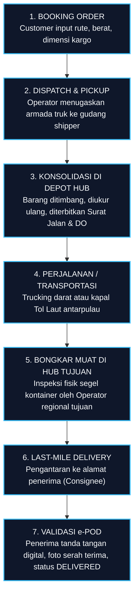
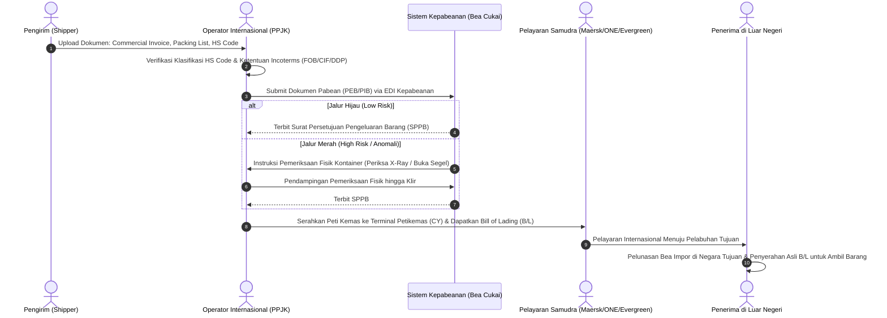
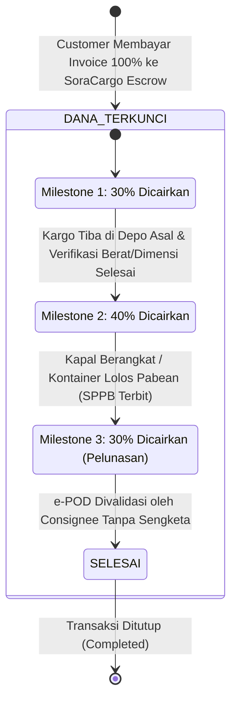

# Mekanisme Pengiriman & Pembagian Finansial (Shipping & Financial Split)

Dokumen ini menjelaskan alur operasional pengiriman barang (Domestik vs. Internasional Ekspor-Impor), klasifikasi dokumen legal, jalur kepabeanan (*Customs Clearance*), matriks pembagian pendapatan (*Revenue Split*), serta sistem penjaminan dana berjenjang (*Milestone Escrow*).

---

## 1. Mekanisme Pengiriman Barang

SoraCargo menangani dua kategori jalur pengiriman dengan kompleksitas dan kepatuhan hukum yang berbeda:

```text
┌────────────────────────────────────────────────────────────────────────────────────────┐
│                              SORA CARGO SHIPPING ENGINE                                │
└───────────────────────────────────┬────────────────────────────────────────────────────┘
                                    │
           ┌────────────────────────┴────────────────────────┐
           ▼                                                 ▼
┌─────────────────────────────────────┐   ┌──────────────────────────────────────────────┐
│        PENGIRIMAN DOMESTIK          │   │      PENGIRIMAN INTERNASIONAL (EKSPOR-IMPOR)  │
├─────────────────────────────────────┤   ├──────────────────────────────────────────────┤
│ • Antarpulau & Antarkota Indonesia  │   │ • Lintas Batas Negara (Cross-Border)         │
│ • Jalur: Truk, Kereta, Kapal Roro   │   │ • Jalur: Kapal Samudra (FCL/LCL), Air Freight│
│ • Tanpa Pemeriksaan Bea Cukai       │   │ • Wajib Melalui Pabean & Bea Cukai           │
│ • Dokumen: Surat Jalan, DO, e-POD   │   │ • Dokumen: B/L, PEB, PIB, HS Code, Invoice   │
│ • Lead Time: 1 - 7 Hari             │   │ • Lead Time: 5 - 45 Hari                     │
└─────────────────────────────────────┘   └──────────────────────────────────────────────┘
```

---

### A. Pengiriman Domestik (Nusantara Cargo)

Alur pengiriman barang di dalam wilayah kepulauan Republik Indonesia:



#### Dokumen Kunci Domestik:
1. **Surat Jalan (Consignment Note)**: Bukti serah terima muatan antara pengirim dan pengemudi armada.
2. **Delivery Order (DO)**: Dokumen otorisasi dari pemilik barang kepada operator untuk mengambil kargo di depo.
3. **Surat Muatan Kapal (SMK)**: Manifest resmi untuk pengangkutan via kapal roro/kontainer domestik.
4. **e-POD (Electronic Proof of Delivery)**: Bukti penerimaan digital dilengkapi koordinat GPS dan foto penerima.

---

### B. Pengiriman Internasional (Ekspor - Impor)

Alur pengiriman lintas batas negara melibatkan multi-institusi (Shipper, Otoritas Pelabuhan, Bea Cukai, Operator PPJK, Perusahaan Pelayaran Samudra, dan Consignee):



#### Dokumen Kunci Internasional:
1. **Commercial Invoice & Packing List**: Rincian nilai komersial barang, mata uang transaksi, berat kotor (*gross weight*), dan berat bersih (*net weight*).
2. **Klasifikasi HS Code (Harmonized System)**: Kode 8-10 digit standar internasional untuk menentukan besaran tarif bea masuk dan larangan pembatasan (Lartas).
3. **Pemberitahuan Ekspor/Impor Barang (PEB / PIB)**: Dokumen deklarasi pabean resmi kepada Direktorat Jenderal Bea dan Cukai.
4. **Bill of Lading (B/L) / Air Waybill (AWB)**: Dokumen kepemilikan barang (*document of title*) dan bukti kontrak pengangkutan laut/udara internasional.
5. **Certificate of Origin (COO / Form D/E/AK)**: Surat Keterangan Asal untuk mendapatkan tarif preferensial perjanjian perdagangan bebas (FTA).

#### Jalur Kepabeanan (*Customs Channels*):
- **Jalur Hijau**: Kargo profil risiko rendah; persetujuan pengeluaran (SPPB) terbit otomatis tanpa pemeriksaan fisik maupun dokumen.
- **Jalur Kuning**: Dilakukan pemeriksaan dokumen pendukung pabean sebelum SPPB diterbitkan.
- **Jalur Merah**: Wajib pemeriksaan fisik peti kemas (pembongkaran kontainer di depo pabean / pemindaian X-Ray) dan validasi dokumen mendalam.

---

## 2. Model Finansial & Matriks Pembagian Hasil (Revenue Split)

Setiap pembayaran invoice kargo dari pelanggan dialokasikan secara transparan ke tiga pos utama: **Admin Platform**, **Operator / Vendor Armada**, dan **Regulasi / Pajak / Retribusi**:

| Pos Alokasi | Pengiriman Domestik (%) | Pengiriman Internasional (%) | Komponen Pembiayaan yang Ditanggung |
| :--- | :---: | :---: | :--- |
| **Admin SoraCargo (Platform)** | **12% – 15%** | **10% – 15%** | • Pemeliharaan server cloud & arsitektur Podman/OCI.<br/>• Layanan WhatsApp Gateway & AI Copilot.<br/>• Keamanan sistem, audit kepatuhan, margin profit platform. |
| **Operator / Vendor Armada** | **77% – 80%** | **60% – 70%** | • Bahan bakar minyak (BBM / Bunker).<br/>• Gaji supir trailer / awak nahkoda kapal.<br/>• Biaya tol Trans-Jawa / biaya penyeberangan fery.<br/>• Ocean Freight kapal kontainer samudra.<br/>• Biaya depo, trucking pick-up, dan last-mile delivery. |
| **Regulasi, Pajak & Legalitas** | **5% – 8%** | **15% – 25%** | • **Domestik**: PPN Jasa Logistik (1.1%), retribusi terminal daerah, asuransi dasar perjalanan.<br/>• **Internasional**: Bea Masuk (0-30% tergantung HS Code), Pajak Impor PDRI (PPN 11%, PPh 22 2.5-7.5%), Terminal Handling Charges (THC), PNBP Bea Cukai, sertifikasi karantina. |

---

## 3. Sistem Rekening Bersama (Milestone Escrow Mechanism)

Untuk melindungi Customer dari wanprestasi dan melindungi Operator dari gagal bayar, SoraCargo menerapkan **Sistem Rekening Bersama Berbasis Milestone (Milestone Escrow)**:



### Rincian Tahap Pencairan Dana (*Milestones*):

1. **Milestone 1: Booking & Verifikasi Depo Asal (30% Cair)**
   - **Kondisi**: Armada operator telah menjemput barang dari lokasi pengirim (*shipper*) dan kargo tiba di depo hub asal untuk dilakukan penimbangan dan verifikasi volume.
   - **Tujuan**: Memberikan modal kerja awal bagi operator untuk pengisian BBM, uang saku supir, atau *stuffing* kontainer.

2. **Milestone 2: Keberangkatan Armada / Kliring Pabean (40% Cair)**
   - **Kondisi**:
     - *Domestik*: Armada truk melewati gerbang tol pertama atau kapal Tol Laut telah lepas tali jangkar (*cast off*).
     - *Internasional*: Dokumen ekspor/impor disetujui (SPPB keluar dari Bea Cukai) dan kontainer telah dimuat ke atas kapal samudra (*On Board Bill of Lading*).
   - **Tujuan**: Membayar biaya transit, tiket penyeberangan fery antarpulau, atau pembayaran *Ocean Freight* ke maskapai pelayaran.

3. **Milestone 3: Penyelesaian & Serah Terima e-POD (30% Sisa Dana Cair)**
   - **Kondisi**: Penerima kargo (*Consignee*) telah menerima muatan, menandatangani berita acara serah terima secara digital (*e-POD*), dan tidak ada keluhan dalam tenggat waktu konfirmasi 24 jam.
   - **Tujuan**: Pelunasan komisi bersih untuk operator dan penutupan buku pesanan secara resmi.

---

## 4. Mekanisme Penanganan Sengketa (Dispute & Claim Hold)

Jika selama proses pengiriman terjadi anomali (barang rusak, koli hilang, atau keterlambatan parah):
1. **Freeze Milestone**: Superadmin dapat membekukan pencairan Milestone 2 atau Milestone 3 secara instan melalui portal admin.
2. **Klaim Asuransi**: Operator mengunggah Berita Acara Kerusakan Barang (BAP). Tim asuransi mitra SoraCargo memproses ganti rugi.
3. **Penyelesaian Dana**: Jika kerusakan murni kelalaian vendor armada, dana escrow yang ditahan dialihkan sebagai kompensasi pengembalian dana (*refund*) kepada pelanggan.

