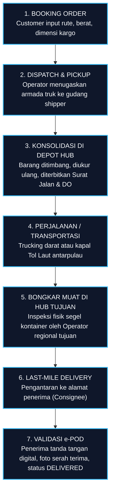
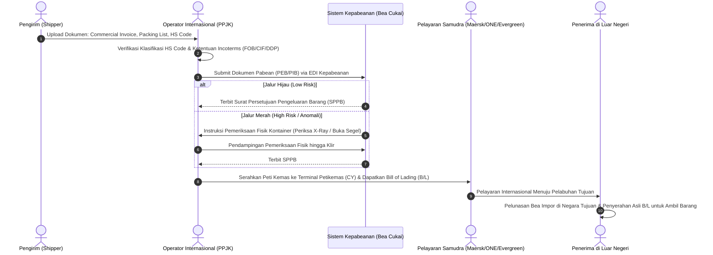
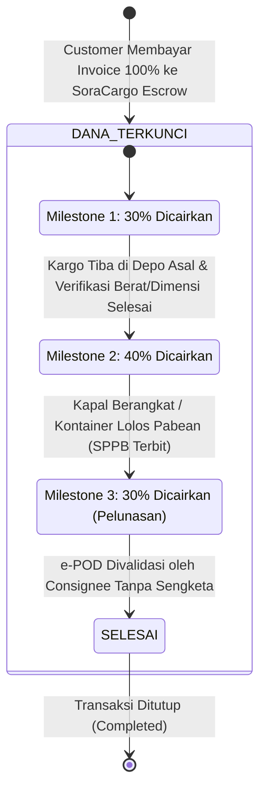
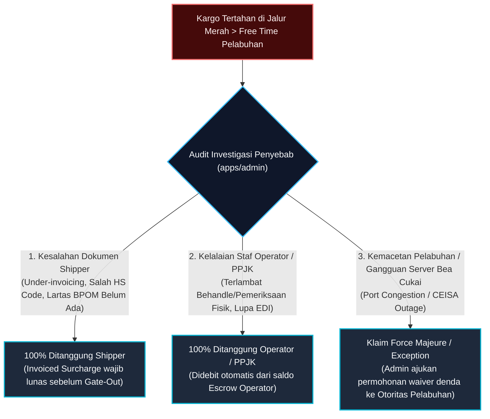
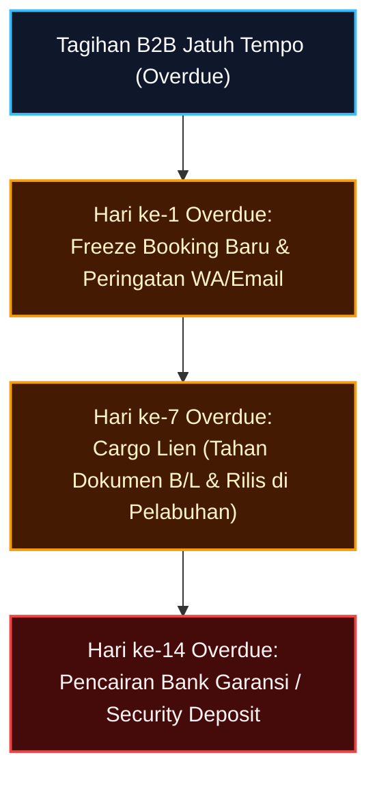

# Mekanisme Pengiriman & Pembagian Finansial (Shipping & Financial Split)

Dokumen ini menjelaskan alur operasional pengiriman barang (Domestik vs. Internasional Ekspor-Impor), klasifikasi dokumen legal, jalur kepabeanan (*Customs Clearance*), matriks pembagian pendapatan (*Revenue Split*), serta sistem penjaminan dana berjenjang (*Milestone Escrow*).

---

## 1. Mekanisme Pengiriman Barang

SoraCargo menangani dua kategori jalur pengiriman dengan kompleksitas dan kepatuhan hukum yang berbeda:

```text
┌────────────────────────────────────────────────────────────────────────────────────────┐
│                              SORA CARGO SHIPPING ENGINE                                │
└───────────────────────────────────┬────────────────────────────────────────────────────┘
                                    │
           ┌────────────────────────┴────────────────────────┐
           ▼                                                 ▼
┌─────────────────────────────────────┐   ┌──────────────────────────────────────────────┐
│        PENGIRIMAN DOMESTIK          │   │      PENGIRIMAN INTERNASIONAL (EKSPOR-IMPOR)  │
├─────────────────────────────────────┤   ├──────────────────────────────────────────────┤
│ • Antarpulau & Antarkota Indonesia  │   │ • Lintas Batas Negara (Cross-Border)         │
│ • Jalur: Truk, Kereta, Kapal Roro   │   │ • Jalur: Kapal Samudra (FCL/LCL), Air Freight│
│ • Tanpa Pemeriksaan Bea Cukai       │   │ • Wajib Melalui Pabean & Bea Cukai           │
│ • Dokumen: Surat Jalan, DO, e-POD   │   │ • Dokumen: B/L, PEB, PIB, HS Code, Invoice   │
│ • Lead Time: 1 - 7 Hari             │   │ • Lead Time: 5 - 45 Hari                     │
└─────────────────────────────────────┘   └──────────────────────────────────────────────┘
```

---

### A. Pengiriman Domestik (Nusantara Cargo)

Alur pengiriman barang di dalam wilayah kepulauan Republik Indonesia:



#### Dokumen Kunci Domestik:
1. **Surat Jalan (Consignment Note)**: Bukti serah terima muatan antara pengirim dan pengemudi armada.
2. **Delivery Order (DO)**: Dokumen otorisasi dari pemilik barang kepada operator untuk mengambil kargo di depo.
3. **Surat Muatan Kapal (SMK)**: Manifest resmi untuk pengangkutan via kapal roro/kontainer domestik.
4. **e-POD (Electronic Proof of Delivery)**: Bukti penerimaan digital dilengkapi koordinat GPS dan foto penerima.

---

### B. Pengiriman Internasional (Ekspor - Impor)

Alur pengiriman lintas batas negara melibatkan multi-institusi (Shipper, Otoritas Pelabuhan, Bea Cukai, Operator PPJK, Perusahaan Pelayaran Samudra, dan Consignee):



#### Dokumen Kunci Internasional:
1. **Commercial Invoice & Packing List**: Rincian nilai komersial barang, mata uang transaksi, berat kotor (*gross weight*), dan berat bersih (*net weight*).
2. **Klasifikasi HS Code (Harmonized System)**: Kode 8-10 digit standar internasional untuk menentukan besaran tarif bea masuk dan larangan pembatasan (Lartas).
3. **Pemberitahuan Ekspor/Impor Barang (PEB / PIB)**: Dokumen deklarasi pabean resmi kepada Direktorat Jenderal Bea dan Cukai.
4. **Bill of Lading (B/L) / Air Waybill (AWB)**: Dokumen kepemilikan barang (*document of title*) dan bukti kontrak pengangkutan laut/udara internasional.
5. **Certificate of Origin (COO / Form D/E/AK)**: Surat Keterangan Asal untuk mendapatkan tarif preferensial perjanjian perdagangan bebas (FTA).

#### Jalur Kepabeanan (*Customs Channels*):
- **Jalur Hijau**: Kargo profil risiko rendah; persetujuan pengeluaran (SPPB) terbit otomatis tanpa pemeriksaan fisik maupun dokumen.
- **Jalur Kuning**: Dilakukan pemeriksaan dokumen pendukung pabean sebelum SPPB diterbitkan.
- **Jalur Merah**: Wajib pemeriksaan fisik peti kemas (pembongkaran kontainer di depo pabean / pemindaian X-Ray) dan validasi dokumen mendalam.

---

## 2. Model Finansial & Matriks Pembagian Hasil (Revenue Split)

Setiap pembayaran invoice kargo dari pelanggan dialokasikan secara transparan ke tiga pos utama: **Admin Platform**, **Operator / Vendor Armada**, dan **Regulasi / Pajak / Retribusi**:

| Pos Alokasi | Pengiriman Domestik (%) | Pengiriman Internasional (%) | Komponen Pembiayaan yang Ditanggung |
| :--- | :---: | :---: | :--- |
| **Admin SoraCargo (Platform)** | **12% – 15%** | **10% – 15%** | • Pemeliharaan server cloud & arsitektur Podman/OCI.<br/>• Layanan WhatsApp Gateway & AI Copilot.<br/>• Keamanan sistem, audit kepatuhan, margin profit platform. |
| **Operator / Vendor Armada** | **77% – 80%** | **60% – 70%** | • Bahan bakar minyak (BBM / Bunker).<br/>• Gaji supir trailer / awak nahkoda kapal.<br/>• Biaya tol Trans-Jawa / biaya penyeberangan fery.<br/>• Ocean Freight kapal kontainer samudra.<br/>• Biaya depo, trucking pick-up, dan last-mile delivery. |
| **Regulasi, Pajak & Legalitas** | **5% – 8%** | **15% – 25%** | • **Domestik**: PPN Jasa Logistik (1.1%), retribusi terminal daerah, asuransi dasar perjalanan.<br/>• **Internasional**: Bea Masuk (0-30% tergantung HS Code), Pajak Impor PDRI (PPN 11%, PPh 22 2.5-7.5%), Terminal Handling Charges (THC), PNBP Bea Cukai, sertifikasi karantina. |

---

## 3. Sistem Rekening Bersama (Milestone Escrow Mechanism)

Untuk melindungi Customer dari wanprestasi dan melindungi Operator dari gagal bayar, SoraCargo menerapkan **Sistem Rekening Bersama Berbasis Milestone (Milestone Escrow)**:



### Rincian Tahap Pencairan Dana (*Milestones*):

1. **Milestone 1: Booking & Verifikasi Depo Asal (30% Cair)**
   - **Kondisi**: Armada operator telah menjemput barang dari lokasi pengirim (*shipper*) dan kargo tiba di depo hub asal untuk dilakukan penimbangan dan verifikasi volume.
   - **Tujuan**: Memberikan modal kerja awal bagi operator untuk pengisian BBM, uang saku supir, atau *stuffing* kontainer.

2. **Milestone 2: Keberangkatan Armada / Kliring Pabean (40% Cair)**
   - **Kondisi**:
     - *Domestik*: Armada truk melewati gerbang tol pertama atau kapal Tol Laut telah lepas tali jangkar (*cast off*).
     - *Internasional*: Dokumen ekspor/impor disetujui (SPPB keluar dari Bea Cukai) dan kontainer telah dimuat ke atas kapal samudra (*On Board Bill of Lading*).
   - **Tujuan**: Membayar biaya transit, tiket penyeberangan fery antarpulau, atau pembayaran *Ocean Freight* ke maskapai pelayaran.

3. **Milestone 3: Penyelesaian & Serah Terima e-POD (30% Sisa Dana Cair)**
   - **Kondisi**: Penerima kargo (*Consignee*) telah menerima muatan, menandatangani berita acara serah terima secara digital (*e-POD*), dan tidak ada keluhan dalam tenggat waktu konfirmasi 24 jam.
   - **Tujuan**: Pelunasan komisi bersih untuk operator dan penutupan buku pesanan secara resmi.

---

## 4. Mekanisme Penanganan Sengketa (Dispute & Claim Hold)

Jika selama proses pengiriman terjadi anomali (barang rusak, koli hilang, atau keterlambatan parah):
1. **Freeze Milestone**: Superadmin dapat membekukan pencairan Milestone 2 atau Milestone 3 secara instan melalui portal admin.
2. **Klaim Asuransi**: Operator mengunggah Berita Acara Kerusakan Barang (BAP). Tim asuransi mitra SoraCargo memproses ganti rugi.
3. **Penyelesaian Dana**: Jika kerusakan murni kelalaian vendor armada, dana escrow yang ditahan dialihkan sebagai kompensasi pengembalian dana (*refund*) kepada pelanggan.

---

## 5. Kebijakan Pembatalan (*Cancellation*) & Skema Denda Sunk Costs

Pembatalan pesanan oleh *Shipper* diperhitungkan secara adil berdasarkan biaya riil yang sudah dikeluarkan oleh armada dan depo (*Logistics Sunk Costs*):

| Tahapan Pembatalan | Kondisi Operasional di Lapangan | Denda / Biaya Hangus | Pengembalian (*Refund*) ke Shipper | Landasan Operasional |
| :--- | :--- | :---: | :---: | :--- |
| **Tahap A: Early Cancellation** | Booking disetujui, namun armada penjemputan belum bergerak ke lokasi shipper. | **5% – 10%** *(Admin Fee)* | **90% – 95%** | Belum timbul biaya fisik armada; hanya kompensasi alokasi sistem & reservasi slot rute. |
| **Tahap B: Gate-In Depo** | Truk telah menjemput muatan dan kontainer/barang telah masuk ke depo hub asal (*Gate-In*). | **30% – 50%** | **50% – 70%** | Operator telah mengeluarkan biaya BBM truk pick-up, upah supir, buruh muat (*stuffing*), dan biaya angkat kontainer (*lift on/lift off*). Ongkos kirim balik (*re-delivery*) ditanggung shipper. |
| **Tahap C: Port Clearance** | Dokumen pabean telah diajukan (PEB/PIB) & kontainer berada di dermaga pelabuhan (*Stacking Area*). | **60% – 80%** | **20% – 40%** | Biaya administrasi pabean hangus, pembatalan izin muat pelabuhan, serta penalti pembatalan ruang kapal (*Deadfreight fee* dari shipping line). |
| **Tahap D: On-Board Sailing** | Kapal telah lepas tali jangkar (*Cast Off / En-Route*). | **100% Hangus** | **0% (Tidak Ada Refund)** | Sesuai hukum maritim internasional, muatan tidak dapat diturunkan di tengah laut. Jika shipper memaksa batal, muatan dialihkan di pelabuhan singgah berikutnya dengan biaya re-ekspor penuh ditanggung shipper. |

---

## 6. Tanggung Jawab Denda Inap (*Demurrage & Detention*) di Jalur Merah

Di pelabuhan, otoritas dan *shipping line* memberikan masa bebas penumpukan peti kemas (*Free Time*, rata-rata 3–7 hari kalender). Jika kontainer tertahan di **Jalur Merah Bea Cukai** melebihi *free time*, beban biaya sewa kontainer (*detention*) dan sewa lahan depo pelabuhan (*demurrage*) ditentukan melalui **Audit Penyebab Utama (*Root Cause Attribution*)**:



---

## 7. Skema Pembayaran: Retail Prepaid Escrow vs Corporate B2B Term of Payment (TOP)

Platform SoraCargo mengakomodasi fleksibilitas pembayaran dengan manajemen risiko ketat:

```text
┌───────────────────────────────────────────────┐     ┌───────────────────────────────────────────────┐
│        PELANGGAN RETAIL / UMKM / SHIPPER BARU │     │      PELANGGAN CORPORATE B2B TERVERIFIKASI    │
├───────────────────────────────────────────────┤     ├───────────────────────────────────────────────┤
│ • Model: 100% Prepaid Escrow                  │     │ • Model: Term of Payment (TOP 30 – 60 Hari)   │
│ • Pembayaran lunas di muka sebelum penjemputan│     │ • Tagihan konsolidasian di akhir siklus bulan │
│ • Dana dikunci & dicairkan per milestone      │     │ • Wajib lolos Credit Risk Scoring             │
│ • Risiko piutang macet: 0%                    │     │ • Diberikan Batas Plafon Kredit (Credit Limit)│
│ • Tidak ada persyaratan jaminan bank          │     │ • Wajib jaminan Bank Garansi / Security Depo  │
└───────────────────────────────────────────────┘     └───────────────────────────────────────────────┘
```

### Ketentuan Fasilitas B2B Term of Payment (TOP):
1. **Verifikasi Legalitas & Credit Scoring**: Shipper berbadan hukum (PT/CV) wajib mengunggah NIB, NPWP Perusahaan, rekening koran 3 bulan terakhir, serta laporan keuangan teraudit ke `apps/admin`.
2. **Plafon Kredit (*Credit Limit*)**: Admin menetapkan pagu kredit maksimal (misal: Rp 500.000.000). Jika nilai pengiriman aktif shipper telah menyentuh limit ini, sistem secara otomatis mengunci pembuatan booking baru sampai faktur sebelumnya dibayar.
3. **Perlindungan Likuiditas Operator**: Operator armada tetap menerima pencairan uang jalan (Milestone 1 & 2) tepat waktu dari dana talangan operasional (*working capital*) SoraCargo, sehingga rantai pasok tidak terhambat oleh termin tempo pelanggan B2B.

---

## 8. Mitigasi Risiko Gagal Bayar B2B (3-Tier Automated Debt Enforcement)

Jika pelanggan korporat terlambat melunasi tagihan tempo melewati batas waktu (*Overdue Invoice*), sistem mengeksekusi tindakan pengamanan bertingkat secara otomatis:



1. **Hari ke-1 Overdue (Auto-Freeze Pemesanan Baru)**:
   - Akses pembuatan pesanan kargo baru untuk shipper B2B tersebut otomatis diblokir sistem.
   - Bot WhatsApp & Email Gateway mengirimkan rekapitulasi faktur ke bagian Finance & Purchasing perusahaan shipper.
2. **Hari ke-7 Overdue (Hak Retensi Kargo / Cargo Lien)**:
   - SoraCargo memberlakukan hak retensi kargo (*Maritime Cargo Lien*).
   - Dokumen asli *Bill of Lading* dan Surat Jalan dari pengiriman yang sedang berjalan ditahan di pelabuhan tujuan, sehingga kontainer tidak dapat dikeluarkan dari depo (*Delivery Hold*) sampai tunggakan diselesaikan.
3. **Hari ke-14 Overdue (Klaim Jaminan Bank Garansi / Deposit)**:
   - Superadmin mencairkan instrumen jaminan *Bank Guarantee* atau *Security Deposit* perusahaan yang disimpan di akun penampung untuk melunasi tagihan dan membayar hak komisi operator armada.

---

## 9. Penagihan Transaksi Multi-Currency & 24-Hour Rate-Lock

Untuk pengiriman ekspor-impor internasional yang melibatkan mata uang asing (USD):
1. **Dual-Currency Transparent Breakdown**:
   - Faktur menampilkan rincian biaya asli: *Ocean Freight / Air Freight* ditampilkan dalam **USD (\$)**, sedangkan biaya pabean, Bea Masuk, PPN 11%, dan *handling fee* lokal ditampilkan dalam **IDR (Rp)**.
2. **Kunci Kurs 24 Jam (24-Hour Exchange Rate Lock)**:
   - Saat shipper mengonfirmasi pesanan (*checkout*), total nilai USD dikonversi ke IDR menggunakan nilai kurs tengah Bank Indonesia / Kurs Transaksi Bank saat itu.
   - Nilai konversi IDR ini **dikunci secara tetap selama 24 jam** (*Rate-Lock*), melindungi shipper lokal dari fluktuasi valuta asing saat melakukan transfer pembayaran escrow.

---

## 10. Pengelolaan Kargo Khusus: Dangerous Goods (DG) & Reefer

SoraCargo mengakomodasi muatan berisiko tinggi dan sensitif suhu dengan verifikasi ketat:

1. **Kargo Berbahaya (Dangerous Goods / DG Class 1–9)**:
   - Shipper wajib mengunggah lembar **Material Safety Data Sheet (MSDS)** dan deklarasi kemasan UN-Approved.
   - Sistem mengenakan premi biaya penanganan tambahan (*DG Surcharge* 20% – 35%).
   - Sistem secara otomatis menolak penugasan truk/kapal reguler dan hanya mencocokkan pesanan dengan armada berlisensi izin B3 (Bahan Berbahaya & Beracun) serta penempatan khusus di atas dek kapal (*On-Deck Stowage*).
2. **Kontainer Berpendingin (Reefer Container)**:
   - Shipper wajib menentukan parameter suhu simpan (contoh: `-20°C` untuk ikan beku atau `+4°C` untuk produk farmasi).
   - Biaya pemakaian colokan listrik kapal/depo (*Plugging & Monitoring Fee*) otomatis masuk ke kalkulasi tarif.
   - Sensor telemetri IoT kontainer memantau suhu interior secara berkelanjutan dan memicu peringatan darurat jika suhu berdeviasi lebih dari 2°C.

---

## 11. Standarisasi Format Penomoran Dokumen (Semantic Code Prefix)

Untuk memastikan komunikasi verbal dan operasional yang cepat dan bebas dari kekeliruan antara supir, nahkoda, operator pelabuhan, dan kasir, penomoran dokumen mengadopsi format semantik standar:

| Tipe Dokumen | Format Penomoran | Contoh Nyata | Keterangan Bagian Kode |
| :--- | :--- | :--- | :--- |
| **Resi Pelacakan / Booking** | `SRA-[ORIGIN]-[DEST]-[YYMM]-[SEQ]` | `SRA-SUB-JKT-2611-0089` | SoraCargo, Asal Surabaya, Tujuan Jakarta, Thn 2026 Bln 11, No Urut 0089 |
| **Bill of Lading (B/L) Laut** | `SRA-BL-[HUB]-[YYMM]-[SEQ]` | `SRA-BL-SIN-2611-0042` | B/L Samudra Hub Singapura, Periode Nov 2026 |
| **Surat Jalan Darat (SJ)** | `SRA-SJ-[YYMM]-[SEQ]` | `SRA-SJ-2611-1002` | Surat Jalan Muatan Darat Nusantara |
| **Invoice Tagihan** | `INV-[YYYYMM]-[SEQ]` | `INV-202611-0491` | Faktur Pajak & Tagihan Konsumen |
| **Berita Acara Kerusakan (BAP)** | `BAP-[HUB]-[YYMM]-[SEQ]` | `BAP-BTM-2611-0012` | Laporan Insiden Kargo Hub Pelabuhan Batam |


